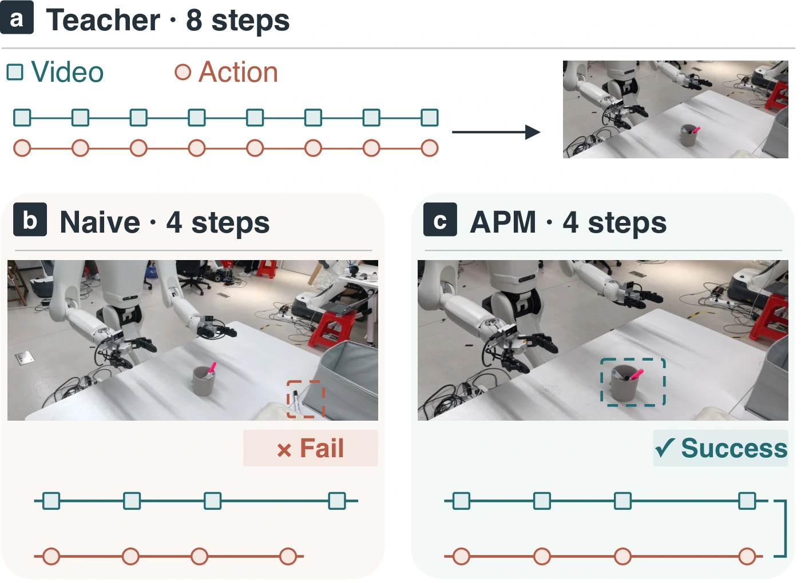
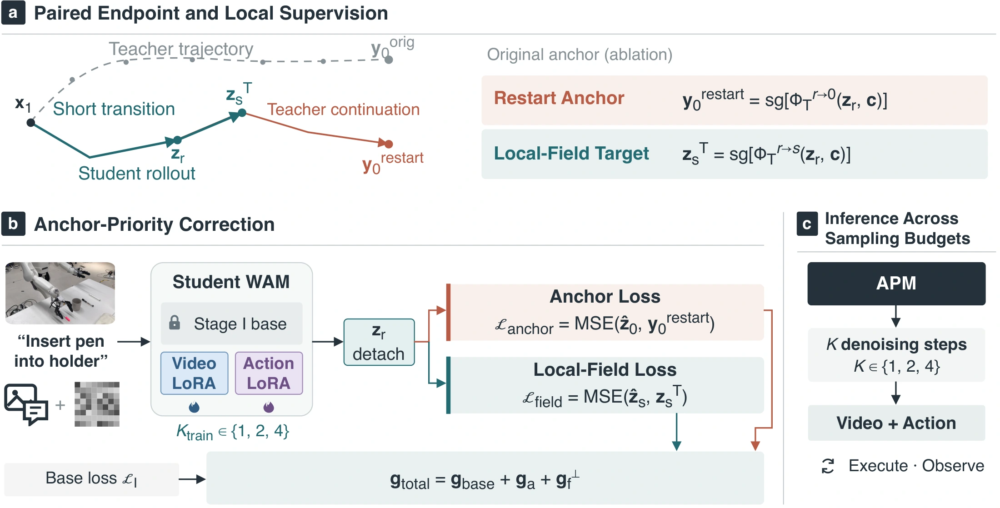
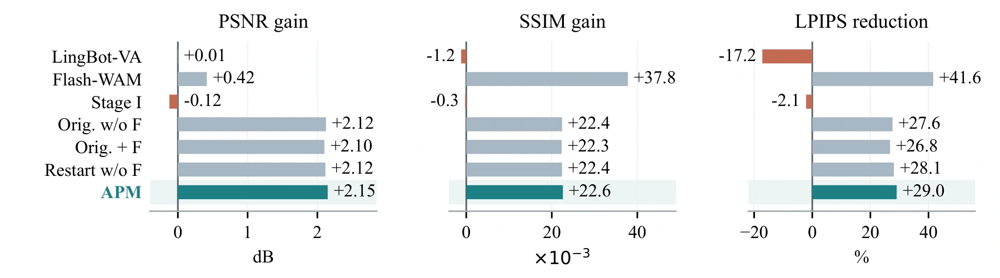
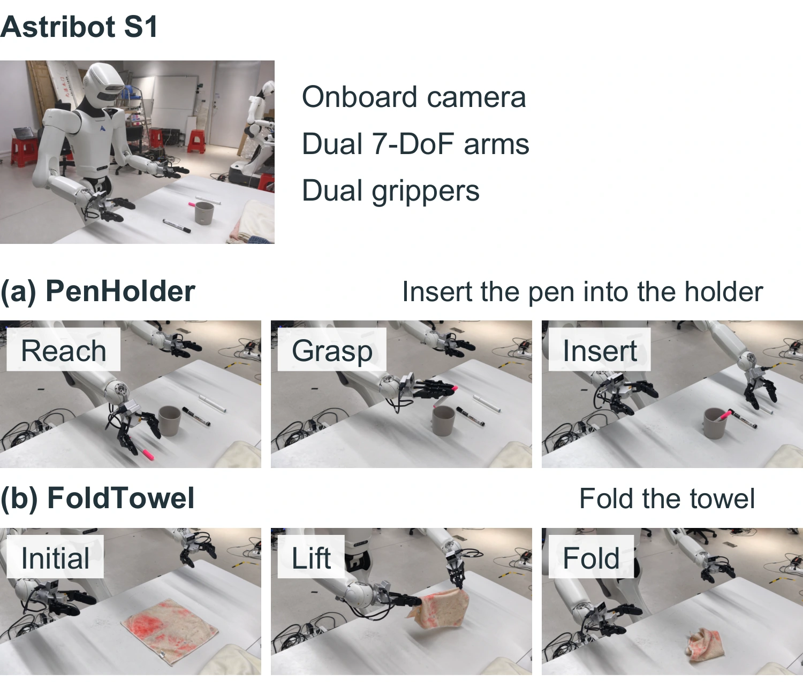

<div align="center">

# Anchored Path Matching

### Distilling World Action Models for Efficient Bimanual Manipulation via Anchored Path Matching

**One checkpoint · 1/2/4-step joint video–action generation · teacher-free deployment**

[](https://jialonglong.github.io/Anchored-Path-Matching/)
[](https://jialonglong.github.io/Anchored-Path-Matching/paper.pdf)
[](https://github.com/JIAlonglong/Anchored-Path-Matching)
[](https://huggingface.co/JIAlonglong/Anchored-Path-Matching)

</div>

World Action Models (WAMs) jointly generate future video and robot actions,
but iterative denoising limits control frequency. Compressing that trajectory
into a few coarse transitions creates a second problem: the student can leave
the dense teacher path and must then predict from states the teacher would not
normally visit.

**Anchored Path Matching (APM)** corrects the model exactly where this drift
occurs. At a detached state reached by the student, one frozen-teacher
continuation supplies two complementary targets: its zero-noise endpoint anchors
the completed video and actions, while its first intermediate state supervises
a short finite-interval transition. Anchor-priority correction preserves the
endpoint gradient whenever the two objectives conflict.



## What APM adds

- **Student-state supervision.** Both correction queries start from the same
  detached state produced by a coarse student rollout.
- **Global and local targets from one continuation.** The restart endpoint
  constrains the final prediction; the first intermediate state calibrates the
  next finite-interval transition without another teacher rollout.
- **Endpoint-priority optimization.** Conflicting local-field gradient
  components are removed independently in the video and action parameter
  groups, while compatible components are retained.
- **One model for several latency budgets.** The same student runs with matched
  video/action grids of 1, 2, and 4 steps; changing the budget requires no
  retraining.
- **Teacher-free deployment.** Teacher integration and gradient correction are
  training-only operations.

## Method



### Stage I: finite-interval joint-map initialization

Starting from LingBot-VA, Stage I learns an AnyFlow-based transition map
`Ψθ(xₜ; t → r, c)` for the coupled video–action latent. The student and frozen
teacher share the same starting state, and the teacher integrates eight steps
to construct each detached target. Stage I is trained for 4,000 optimization
steps and initializes every Stage II variant.

### Stage II: paired supervision at student-reached states

Stage II freezes the Stage I backbone and trains modality-routed LoRA adapters.
At each update it uniformly selects a rollout budget `Ktrain ∈ {1, 2, 4}` and
detaches a correction state `zᵣ` from the student's own path. For the four-step
branch, a `Beta(5, 2)` rule favors later, lower-noise states.

One teacher continuation from `zᵣ` then provides:

1. **Restart anchor:** the teacher endpoint at zero noise,
   `y₀ʳᵉˢᵗᵃʳᵗ = sg[Φᵀʳ→⁰(zᵣ, c)]`.
2. **Local-field target:** the first nonzero-time intermediate state,
   `zₛᵀ = sg[Φᵀʳ→ˢ(zᵣ, c)]`, used to supervise the student's finite-interval
   query from `r` to `s`.

Both losses supervise video and action predictions. The base objective remains
active, while the detached rollout prefix and teacher targets receive no
gradient.

### Anchor-priority correction

Let `gbase`, `ga`, and `gf` be the base, weighted endpoint-anchor, and weighted
local-field gradients (including their loss coefficients). Within each
modality parameter group, APM removes only the component of `gf` that opposes
`ga`:

```text
gf⊥    = gf - min(<gf, ga>, 0) / ||ga||² · ga
gtotal = gbase + ga + gf⊥
```

If `||ga|| = 0`, APM uses `gf⊥ = gf` without projection. The anchor gradient is
never altered. Projection happens after gradient accumulation and distributed
averaging, and before clipping and the optimizer step.

## Results

### RoboTwin 2.0 closed-loop manipulation

All models are trained only on **Clean** demonstrations and evaluated directly
on both Clean and domain-randomized **Random** conditions. Local evaluation
covers 50 tasks × 50 episodes per condition (2,500 episodes each). Continued
uses the same Stage I initialization, trainable parameter count, optimization
settings, and total training budget as APM.

| Video/action steps | Continued Clean | Continued Random | Continued Avg. | APM Clean | APM Random | APM Avg. | Δ Avg. |
|---:|---:|---:|---:|---:|---:|---:|---:|
| 1/1 | 82.3% | 76.1% | 79.2% | **84.3%** | **77.5%** | **80.9%** | **+1.7 pp** |
| 2/2 | 89.6% | **87.7%** | 88.6% | **90.4%** | 87.1% | **88.8%** | **+0.1 pp** |
| 4/4 | 90.5% | 89.1% | 89.8% | **92.5%** | **90.3%** | **91.4%** | **+1.6 pp** |

Average deltas are computed before rounding, following the paper.

The same APM checkpoint produces every row. At one step, APM improves over
Continued by 2.0 percentage points on Clean and 1.4 points on Random; at four
steps, the gains are 2.0 and 1.2 points.

### Single-step video prediction

Ground-truth-conditioned evaluation uses 500 shared RoboTwin contexts at a 1/1
video/action budget. APM increases PSNR from **30.169 to 32.317 dB**, improves
SSIM by `22.6 × 10⁻³`, and reduces LPIPS by **29.0%** relative to Continued.



### Astribot S1 deployment

Without task-specific retraining, single-step APM substantially recovers task
success relative to a one-step coarse teacher while retaining low latency.
Success rates use 24 physical trials per method per task.

| Method | Video/action steps | PenHolder | FoldTowel | Control-cycle latency |
|---|---:|---:|---:|---:|
| LingBot-VA teacher | 8/8 | 83.3% | 70.8% | 4323.6 ms |
| Coarse teacher | 1/1 | 29.2% | 25.0% | **187.5 ms** |
| **APM** | **1/1** | **62.5%** | **75.0%** | 203.1 ms |

APM reduces latency by **21.3×** relative to the eight-step teacher.



## Repository map

| Path | Purpose |
|---|---|
| [`anchorstep/core/`](anchorstep/core/) | Stage I flow map and the current instantaneous-field Stage II objectives |
| [`anchorstep/training/`](anchorstep/training/) | Gradient routing, projection, EMA, and checkpoints |
| [`anchorstep/backends/`](anchorstep/backends/) | Public backend contract plus LingBot/mock integrations |
| [`anchorstep/robotwin/`](anchorstep/robotwin/) | Multi-budget inference and RoboTwin evaluation |
| [`configs/`](configs/) | Paper training, ablation, deployment, and CFG contracts |
| [`docs/training.md`](docs/training.md) | Stage I/II training protocol |
| [`docs/evaluation.md`](docs/evaluation.md) | Deterministic Clean/Random evaluation protocol |
| [`MODEL_ZOO.md`](MODEL_ZOO.md) | Paper-role-to-checkpoint map and materialization notes |

## Quick start

### Installation

```bash
git clone https://github.com/JIAlonglong/Anchored-Path-Matching.git
cd Anchored-Path-Matching
python -m pip install -e '.[dev]'
```

LingBot-VA and RoboTwin are external dependencies and are not vendored. Their
audited revisions and license notices are recorded in
[`THIRD_PARTY_NOTICES.md`](THIRD_PARTY_NOTICES.md). Put machine-specific paths
and runtime factories in a private overlay based on `configs/local.example.yaml`;
do not commit that overlay.

### Simulator-free preflight

This validates the formal Stage II configuration without allocating CUDA
memory, loading model weights, or importing RoboTwin:

```bash test=preflight
python -m anchorstep.cli.train --config configs/model/lingbot_robotwin.yaml --config configs/train/stage2.yaml --config configs/ablation/apm.yaml --check-only
```

### Current training entry points

```bash
# Stage I: 4,000 optimization steps
bash scripts/train_stage1.sh --config /path/to/private-local.yaml

# Stage II: 5,000 additional optimization steps
bash scripts/train_stage2.sh --config /path/to/private-local.yaml
```

These commands run the current instantaneous-field implementation described in
[`docs/training.md`](docs/training.md), not the finite-interval paper target
described above. The paper configuration uses batch size 32, FFN LoRA rank 64,
temporal LoRA rank 128, eight teacher integration steps, and uniformly sampled
Stage II budgets `{1, 2, 4}`.

### Inference and evaluation

`anchorstep.robotwin.inference.rollout_student` accepts `steps=1`, `2`, or `4`
and calls the student exactly that many times without querying the teacher.
For RoboTwin evaluation:

```bash
bash scripts/eval_robotwin.sh --config /path/to/private-local.yaml
```

Use a distinct result directory whenever the sampling budget or CFG changes.
The full result schema and resume behavior are documented in
[`docs/evaluation.md`](docs/evaluation.md).

## Models and ablations

Verified target/EMA inference weights are hosted at
[Hugging Face](https://huggingface.co/JIAlonglong/Anchored-Path-Matching).
The release separates shared bases from allowlisted adapter tensors and verifies
every materialized variant against its immutable source state.

| Public ID | Endpoint anchor | Local field | Projection |
|---|---|---:|---:|
| `continued` | none | no | no |
| `original-no-field` | original prior | no | no |
| `original-field-projected` | original prior | yes | yes |
| `restart-no-field` | student-reached restart | no | no |
| `restart-field-no-projection` | student-reached restart | yes | no |
| `apm` | student-reached restart | yes | yes |

The model repository is intentionally marked **uploading/incomplete** while the
formal `restart-field-no-projection` EMA role remains unresolved. It is not
silently replaced with a semantically different checkpoint. See
[`MODEL_ZOO.md`](MODEL_ZOO.md) and the Hub `manifest.json` for exact artifact
status, hashes, and materialization commands.

## Guidance contract

The paper deployment uses model-specific classifier-free guidance settings.
The APM protocol records text-condition dropout `0.1`, teacher-target
video/action CFG `5/1`, deployment CFG `5/1`, and inference-composed guidance.
Text-condition dropout is a conditioning probability—not a guidance scale.
Every formal run records teacher-target and deployment CFG independently.

## License and scope

Code is released under the [Apache License 2.0](LICENSE). External datasets,
simulator assets, LingBot-VA code and teacher weights, optimizer/scheduler
states, and trainer recovery state are not redistributed and retain their own
terms.

This repository is research code, not a production robot safety controller.
Physical deployment requires independent validation of action bounds,
collision handling, emergency stops, and task-specific safety constraints.
